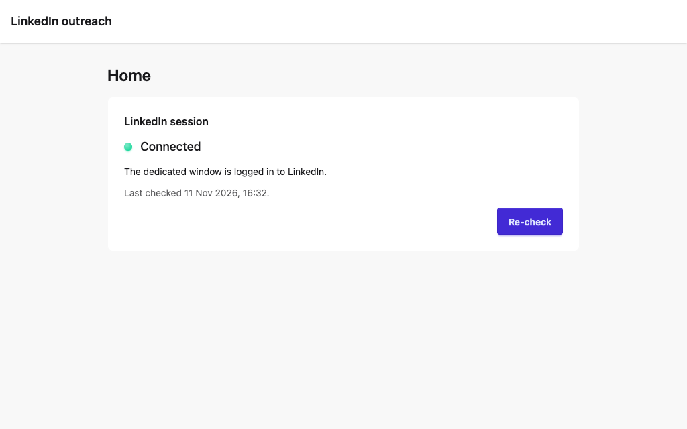
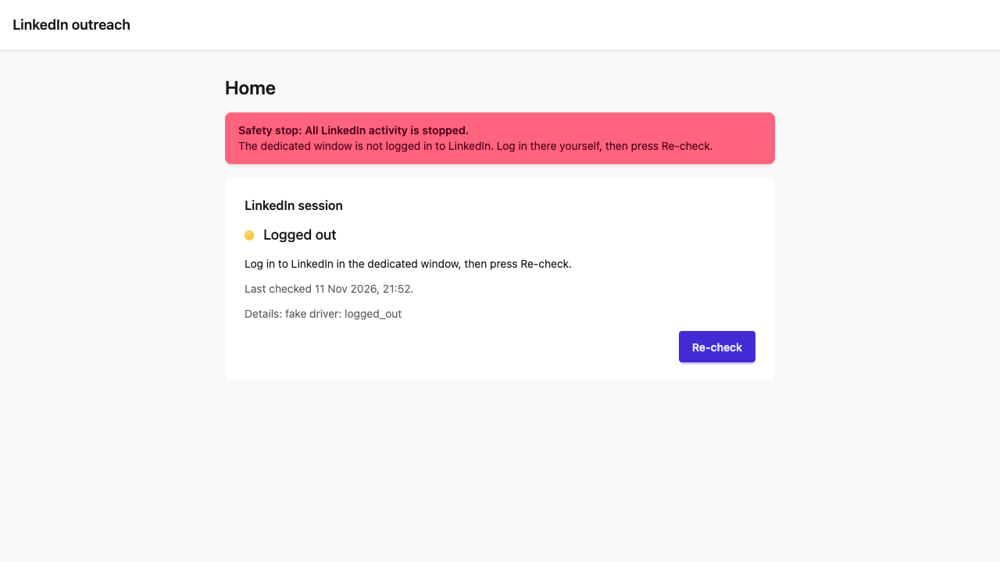
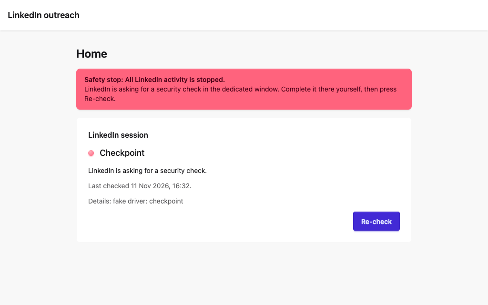

# Milestone 1 report

2026-11-11. Repository, skeleton, `setup` / `start` / `doctor`, database, dedicated Chrome window, session and health detection, read-only driver, fixtures.

**Status: ready for the gate, with one check not done.** `live:check` passed with the LinkedIn interface in English. It has not been run in Italian, because that needs the account's language setting changed and I have not been told I may change it (question 4 below).

## What was built

| Part | Where | Pull request |
| --- | --- | --- |
| Skeleton, `npm run verify`, CI on macOS | `package.json`, `.github/workflows/verify.yml` | #1 |
| SQLite, migrations, settings, `setup`, `doctor` | `src/db/`, `drizzle/`, `scripts/setup.sh`, `src/doctor/` | #2 |
| Dedicated Chrome window, profile lock, session classification, pacing, capture tool | `src/linkedin/{browser,session,human,pageHealth}.ts`, `scripts/linkedin-open.ts`, `scripts/live-capture.ts` | #3 |
| Local server (127.0.0.1, Host and Origin checks), session API, dashboard shell with safety-stop banner | `src/server/`, `src/ui/`, `e2e/` | #4 |
| Scrubber and leak guard for fixtures | `src/linkedin/scrub.ts`, `src/linkedin/fixtures.test.ts` | #5 |
| Parsers: search, connections, sent invitations | `src/linkedin/parse/` | #6 |
| Parser: recommendations (My Network → Grow) | `src/linkedin/parse/recommendations.ts`, `docs/research/recommendations-surface.md` | #7 |
| Parser: profile | `src/linkedin/parse/profile.ts` | #8 |
| Parser: thread and conversation list | `src/linkedin/parse/thread.ts` | #9 |
| Read-only driver, `live:check`, parsers for later page loads | `src/linkedin/driver.ts`, `scripts/live-check.ts`, `docs/research/thread-navigation.md` | #10 |

Decisions are in `docs/decisions.md` (21 entries).

## Checks run

### `npm run verify` (typecheck, lint, unit tests, UI build, dashboard browser test on the fake driver)

```
 Test Files  23 passed (23)
      Tests  524 passed (524)
  2 passed (6.5s)
```

Run locally on the head of pull request #10. CI ran green on every merge to `main` up to #9. For #10 GitHub Actions had a major outage (githubstatus.com, 2026-11-11 about 21:00 UTC) and the runs stayed queued; see "Not verified".

### `npm run live:check` on the real account, English interface

```
ok session state=ok
lang en
ok searchPeople cards=10 hasNextPage=true capped=false hidden=0
ok listRecommendations cards=56
ok viewProfile degree=2 state=can_connect message=true memberId=true experience=5 about=true
ok listRecentConnections cards=58 dated=58 memberIds=58
ok listSentInvitations cards=2
ok readThread kind=unknown isNew=true messages=0 fromUser=0 fromParticipant=0 threadUrl=false
ok readThread(existing) kind=message messages=6 fromUser=3 fromParticipant=3 threadUrl=false
results saved in the data directory: live-check/2026-11-11T20-57-58-465Z.json
live:check: OK
```

The output holds counts only. The parsed people are in the data directory. A readable sample for the gate is at `~/Library/Application Support/linkedin-outreach/live-check/sample-2026-11-11.md` (not in the repository).

This is the run on the final code of pull request #10, after the review fixes. `--thread-member` adds the `readThread(existing)` line: a connection you have already exchanged messages with.

### Session survives an app restart

`NO_OPEN=1 npm start` twice in a row on the live driver, 30 s apart, no login in between:

```
LinkedIn outreach is running at http://localhost:4747 (LinkedIn driver: live). Press Ctrl+C to stop.
dedicated window: Google Chrome, profile …/linkedin-outreach/chrome-profile
LinkedIn session: ok
```

Same three lines on both runs. The login also survived more than ten separate window launches during the day.

### `npm run doctor`

```
[ok]      node: v22.23.2
[ok]      chrome: 157.0.8103.51 at /Applications/Google Chrome.app
[ok]      data directory: … (mode 700, all sub-directories mode 700)
[ok]      database: …/app.db, integrity ok, migrations applied 1 of 1
[ok]      session: status ok, last check 2026-11-11T20:46:08.664Z, last error none
[ok]      recent errors: none in event_log
[info]    service: auto-start: not installed (arrives in milestone 4)
[info]    log tail: no log files
doctor: OK
```

### Independent review

`code-review` ran on everything since the first commit, with two reviewers that did not write the code (standards, spec). Fixed from it: `live:check` rejected valid threads; search cap now throws `SearchCapped`; an unrecognised page ends `live:check`; a logged-out window shows the banner; the data directory is created with mode 700 whichever command runs first; `listConversations` removed (not asked for, and loading the inbox opens the newest conversation). Left open: see "Known gaps".

## Screenshots

Dashboard shell on the fake driver:





## What the real account taught us

1. **LinkedIn writes `data-view-name` only into the first page a browser session loads.** Every later load has none. Parsers built on first-load captures failed on the second navigation of `live:check`. They now use hooks present in both variants, and there are fixtures for both. A fixtures-first build would have shipped parsers that work once per launch.
2. **The login page and the signed-in messaging page both embed an invisible reCAPTCHA.** Both were first classified as a checkpoint. Neither was one; the classifier order was fixed with regression tests. No real checkpoint, CAPTCHA or warning appeared at any point.
3. **A conversation can be opened by URL** (`/messaging/compose/?recipient=<member id>`), with no click. For a connection it shows the earlier messages or an empty new-message pane; for a non-connection it shows a new InMail form, which the parser refuses. The member id is a second identifier (`ACoA…`), different from the `/in/<id>` in profile URLs. It comes from Message links.
4. **Recommendations**: My Network → Grow shows grouped people ("People you may know from …", "People in the … industry"), 56 to 80 cards per load. A card has name, headline and a Connect button. It has no location, company or degree.
5. **The 2026 frontend uses hashed class names** on every page except messaging. Selectors use `data-sdui-screen`, `componentkey`, `data-testid`, roles and link patterns.

## Things you should know

- **Chrome was not installed through `setup` the first time.** `brew install --cask google-chrome` exited 0 without installing (a stale record of an old version). I ran `brew install --cask --force google-chrome` by hand, then added that fallback to `setup.sh`. The fallback itself has not been exercised on a machine without Chrome.
- **Two early merges were out of order.** #1 was merged before I had checked for a review bot. #3 was merged before CI had run on its last merge commit (CI was green afterwards). Since then every merge waited for a green CI run.
- **No review bot is installed.** Each pull request was reviewed by the lead session plus CI; `code-review` ran before this gate.
- **Loading the inbox opens the newest conversation.** One capture of `/messaging/` on 2026-11-11 opened your newest InMail and may have marked it read. Three conversations were opened by `readThread` checks (two connections, one earlier InMail contact); assume those are marked read too.
- **About 55 LinkedIn page loads today**, all read-only, 20–40 s apart. The only clicks were by the investigation worker, which opened the Message overlay on two profiles to see how a conversation opens; it typed nothing.
- **Your company page name was in one committed fixture** on the branch of #10 (`two-way-en.html`, the "Page inboxes" box). It is scrubbed now and the fixture script checks for it. The earlier commit stays in the branch history until #10 is squash-merged and the branch deleted. The repository is private.
- **The build session was interrupted several times** by server restarts. Three workers were lost mid-slice; I finished the driver myself instead of delegating it a fourth time. Parser and fixture work stayed with workers.

## Not verified

- **Italian interface.** Every Italian string is marked `// unverified` (53 of them). Nothing was run with the interface in Italian.
- **CI on pull request #10.** Queued during the GitHub Actions outage. #10 is not merged; I will merge it when CI is green.
- Pages never seen on the real account, covered only by hand-written fixtures: a real checkpoint, a real restriction notice, the monthly search-limit notice, a pending invitation on a profile or search row on a later page load, an empty search, a conversation where only you have written.
- `connect_in_more` versus `follow_only` on a profile: the More menu is empty until clicked. The invite step in milestone 4 has to open it.
- What "Show all" opens on the Grow page.
- Conversations longer than the latest batch of messages: older ones are not read.

## Known gaps, planned for milestone 2

- **A safety stop does not persist.** The driver latches inside one process, and the stored session state is overwritten by the next `ok` check. The spec wants a stop that stays until you resume it. This belongs with the engine's safety stop.
- **The `people` table has no member id column** and no lifetime-suppression record. Both are needed before any action is planned.
- **Selectors are not all in the `selectors.*.ts` files** (decision 8); a handful are inline in parsers. Some helpers are duplicated across parsers. Clean-up slice at the start of milestone 2.
- `doctor` shows no log tail because nothing writes log files yet.
- `setup` requires Google Chrome and does not install Playwright's Chromium as a fallback (disk space).

## Questions for the gate

1. **Recommendations surface.** Use My Network → Grow as it is (grouped cards, name and headline only, about 56–80 per load), and open each profile for location, company and degree before scoring? Or do you want a different page?
2. **Parsed prospects.** Does the sample file look right: names, headlines, locations, degrees, the profile's current role?
3. **Merging.** May agents keep merging their own pull requests in this repository once CI and review are clean?
4. **Interface language.** Your LinkedIn is in English. The handoff says "Italian first". Will you switch it to Italian for one `live:check` run, or may I change the setting and switch it back?
5. **daisyUI instead of shadcn/ui.** Confirm or change.
6. **Review bot.** Install Pullfrog on this repository, or keep lead review plus `code-review` / `council` at gates?
